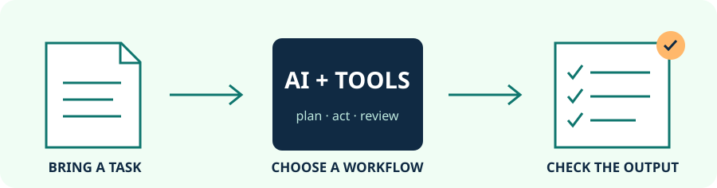

  <h1>Awesome AI for Real Work</h1>
  
  
<strong>让 AI 完成具体工作，并留下能核对的结果。</strong>

  

  <a href="README.md">English version</a>&nbsp; · &nbsp;
  <a href="docs/choosing-tools.md">如何选工具</a>&nbsp; · &nbsp;
  <a href="docs/source-review.md">资料核查</a>&nbsp; · &nbsp;
  <a href="contributing.md">贡献说明</a>

按工作成果整理的 **30 个 AI 项目、9 类任务和 6 份上手流程**。从资料问答、会议纪要和网页整理开始，再扩展到自动化、研究、图表与幻灯片。

先选一件要交付的事，再选工具。每项都注明使用方式和准备条件；可视化软件、桌面应用和开发工具分开标记。星标只是热度参考，不能代替适用性和结果检查。

**第一次来？** 从下面六个任务选一个，使用[原创示例资料](examples/starter-pack.json)试做。流程是写清步骤的蓝图，并非可直接导入各工具的安装包。

## 目录

- [从任务开始](#从任务开始)
- [让 AI 接手多步任务](#让-ai-接手多步任务)
- [把重复任务串成流程](#把重复任务串成流程)
- [把文档变成 AI 能用的资料](#把文档变成-ai-能用的资料)
- [围绕自己的资料问答](#围绕自己的资料问答)
- [把问题整理成有依据的简报](#把问题整理成有依据的简报)
- [让 AI 读取和操作网页](#让-ai-读取和操作网页)
- [从录音提取纪要与待办](#从录音提取纪要与待办)
- [交付图表和演示文稿](#交付图表和演示文稿)
- [检查 AI 有没有做对](#检查-ai-有没有做对)
- [收录与核查](#收录与核查)
- [相关资料](#相关资料)

## 从任务开始

| 我想完成 | 可从这里起步 | 需要交付的结果 |
| --- | --- | --- |
| [根据自己的文档回答问题](workflows/documents-to-answers.md) | AnythingLLM / Docling | 答案附来源；资料没写的内容不猜。 |
| [把会议整理成待办](workflows/meeting-to-actions.md) | Meetily | 转写、决定和确实说过的负责人。 |
| [从网页整理对比表](workflows/browser-to-table.md) | Browser Use / Stagehand | 带来源的表格，缺失字段留空。 |
| [生成数字可复核的周报](workflows/weekly-report.md) | n8n / Data Formulator | 经过计算的指标和简明说明。 |
| [写一份有依据的研究简报](workflows/research-to-brief.md) | GPT Researcher / DeerFlow | 结论、引用与尚未解决的矛盾。 |
| [根据已确认资料制作幻灯片](workflows/sources-to-slides.md) | Presenton | 可编辑、事实和排版都检查过的文稿。 |

六份流程均含英文与中文说明、可复制提示词、示例输入和验收方法。示例的 `expected` 是人为定义的验收目标，并非已经运行 AI 得到的结果。

## 让 AI 接手多步任务

- [OpenClaw](https://github.com/openclaw/openclaw) - 连接模型、工具与消息入口，处理需要多步完成的个人任务。 `智能体 / 需配置`. 先配置模型和可用工具；装在本机不代表所选模型也在本机。起步先给一个只读资料任务。
- [Hermes Agent](https://github.com/NousResearch/hermes-agent) - 可保留上下文、复用技能，通过终端或消息入口完成任务的助理。 `智能体 / 命令行`. 先选模型服务与运行环境。复用前检查自动生成的技能；模型和托管运行环境可能单独收费。
- [Deep Agents](https://github.com/langchain-ai/deepagents) - 提供计划、文件上下文和子任务组件，用来开发持续多步工作的智能体。 `开发工具`. 它是开发底座，需要接入能调用工具的模型、工具和运行环境，并非装好就能用的办公软件。

## 把重复任务串成流程

- [n8n](https://github.com/n8n-io/n8n) - 把触发条件、应用连接和 AI 步骤串成可重复执行的流程。 `可视化 / 自托管或云端`. 按流程准备应用凭据和模型。自托管、云套餐与模型调用分开计费；n8n 使用 fair-code 许可。
- [Activepieces](https://github.com/activepieces/activepieces) - 用现成连接组件和 AI 动作搭建应用之间的工作流。 `可视化 / 自托管或云端`. 只接入当前流程需要的服务。社区版为 MIT，企业功能与托管套餐另有条款。
- [Dify](https://github.com/langgenius/dify) - 通过配置模型、检索文档和编排步骤来创建 AI 应用。 `可视化 / 服务部署`. 需要先有可用实例，并按流程配置模型与嵌入服务。Dify 许可含 Apache 2.0 之外的附加条件。
- [Langflow](https://github.com/langflow-ai/langflow) - 可视化组合 AI 组件，将完成的流程交给应用或其他工具调用。 `桌面或服务部署 / 可视化`. 可以用受支持的桌面包，或自行部署，再配置登录与模型。能拖组件不代表组件已自动配置好。

## 把文档变成 AI 能用的资料

- [Docling](https://github.com/docling-project/docling) - 把文档解析成结构化内容，供检索、提取和后续 AI 流程使用。 `开发工具 / Python`. 先准备解析模型和运行环境。代码为 MIT，模型许可另看说明，复杂排版需要对照原件检查。
- [MinerU](https://github.com/opendatalab/MinerU) - 将复杂 PDF 和办公文档转换成 Markdown 或 JSON，交给后续流程处理。 `文档解析 / 需配置`. 选择适合设备的解析后端并准备模型。许可含附加条件；在线解析服务与本机运行的要求不同。
- [Marker](https://github.com/datalab-to/marker) - 把文档转为 Markdown 或 JSON，并尽量保留版面、表格等结构。 `开发工具 / Python`. 先看当前后端和模型要求。代码为 Apache-2.0，模型权重的商用条款另行规定。
- [MarkItDown](https://github.com/microsoft/markitdown) - 把支持的办公文件等转换成易读的 Markdown，便于检查并交给 AI 工具。 `开发工具 / Python`. 基础转换本身不是 AI 智能体；可选的图片描述、文档智能服务需要另行配置。

## 围绕自己的资料问答

- [AnythingLLM](https://github.com/Mintplex-Labs/anything-llm) - 把文档放进工作区，再通过配置的语言模型和嵌入模型进行问答。 `桌面或自托管`. 可以从桌面版起步。确认模型运行位置、文件解析方式与引用来源；选择云模型时资料可能发给云服务。
- [RAGFlow](https://github.com/infiniflow/ragflow) - 结合文档解析、检索和智能体功能，搭建围绕资料的问答流程。 `服务部署 / 需配置`. 需要服务组件、存储，以及语言模型、嵌入等服务。当前上游 Docker 部署文档不支持 macOS，需按受支持路线准备。
- [Onyx](https://github.com/onyx-dot-app/onyx) - 连接团队资料源，建立索引后进行 AI 搜索和问答。 `团队 / 自托管`. 先配置连接器权限、索引和模型。团队部署还要区分版本许可，并保留原资料的访问边界。
- [Open Notebook](https://github.com/lfnovo/open-notebook) - 把资料、笔记和模型辅助对话放在同一个笔记工作区。 `网页 / 自托管`. 按需要配置语言、嵌入、语音等服务；笔记系统自托管，不代表每种模型服务都在本地。

## 把问题整理成有依据的简报

- [GPT Researcher](https://github.com/assafelovic/gpt-researcher) - 围绕问题搜集资料，整理带来源链接的研究报告。 `研究智能体 / 需配置`. 配置模型、搜索或资料服务，并给每次任务设置预算；逐条核对引用是否支持结论、是否过时。
- [DeerFlow](https://github.com/bytedance/deer-flow) - 结合工具、文件和运行环境，组织较长的研究与内容制作任务。 `智能体平台 / 需配置`. 先配置模型、可选搜索和工具运行环境；执行能力更广，准备工作也比普通搜索框多。

## 让 AI 读取和操作网页

- [Browser Use](https://github.com/browser-use/browser-use) - 让语言模型驱动浏览器，完成页面读取、导航和操作。 `开发工具 / 浏览器智能体`. 代码库、托管浏览器与托管模型是不同服务。建议先从公开网页的只读提取开始，并规定输出字段。
- [Stagehand](https://github.com/browserbase/stagehand) - 在程序中组合浏览器操作与结构化信息提取。 `开发工具 / SDK`. 需要写代码并配置模型；浏览器是否托管取决于使用方式。提取结果应回到原页面核对。
- [Skyvern](https://github.com/Skyvern-AI/skyvern) - 结合页面理解和视觉操作，自动执行浏览器中的流程。 `浏览器流程 / 需配置`. 先准备模型和浏览器环境。本机、自托管与托管服务不同，所用版本需遵守相应 AGPL 等条款。

## 从录音提取纪要与待办

- [faster-whisper](https://github.com/SYSTRAN/faster-whisper) - 通过 CTranslate2 运行 Whisper 模型，将录音转成文字。 `开发工具 / Python`. 先下载模型，并选择 CPU 或兼容的 GPU 环境。它输出转写稿，本身不保证纪要和待办正确。
- [WhisperX](https://github.com/m-bain/whisperX) - 为转写增加对齐、词级时间戳和可选的说话人分离。 `开发工具 / Python`. 对齐和分说话人需要各自的模型，部分下载需服务账户确认访问条件。说话人标签不等于真实身份。
- [Meetily](https://github.com/Zackriya-Solutions/meetily) - 录制或导入会议音频，转写后生成模型辅助纪要。 `桌面 / 本地优先`. 选择本地或云端纪要模型。Windows/macOS 安装包与 Linux 源码部署不同，社区与 PRO 功能也不同；待办要对照录音检查。

## 交付图表和演示文稿

- [Data Formulator](https://github.com/microsoft/data-formulator) - 通过 AI 辅助的数据变换与可视化来探索表格。 `交互式分析 / 需配置`. 先准备数据和受支持的模型。把图表用于报告前，重新核对汇总、筛选条件和分母。
- [Presenton](https://github.com/presenton/presenton) - 根据提供的资料和配置的模型生成、编辑并导出演示文稿。 `桌面或自托管`. 可以从桌面版或自托管应用起步，配置模型和需要的图片服务。导出可编辑 PPTX 后，打开检查实际排版。
- [Banana Slides](https://github.com/Anionex/banana-slides) - 从想法、大纲、资料和视觉参考生成幻灯片。 `网页 / 需配置`. 先配置支持的语言和图像服务，生图可能另收费。可编辑 PPTX 导出目前标为 Beta，需要检查实际文件。
- [PPTAgent](https://github.com/icip-cas/PPTAgent) - 通过智能体辅助的生成与审阅流程制作、修改演示文稿。 `开发工具 / 智能体技能`. 当前主线以智能体技能为入口，需要 Linux/WSL 或 macOS、开发工具及 LibreOffice 等转换依赖；按对应版本配置。

## 检查 AI 有没有做对

- [promptfoo](https://github.com/promptfoo/promptfoo) - 用可复用题目和输出要求，对比不同提示词或模型。 `开发工具 / 命令行`. 模型运行可能付费。确定性规则和模型打分检查的内容不同；要看失败样例，不能只看总分。
- [Langfuse](https://github.com/langfuse/langfuse) - 记录 AI 应用的运行过程，组织评估、数据集和反馈。 `过程追踪 / 需配置`. 先为应用接入追踪，并选择日志存放位置。社区与企业功能不同，记录中可能包含提示词和输出内容。
- [Arize Phoenix](https://github.com/Arize-ai/phoenix) - 查看模型、检索等过程记录，评估 AI 应用的行为。 `过程追踪 / 需配置`. 接入追踪与评估需要配置，也可能调用模型服务。Phoenix 使用 Elastic License 2.0，不应按 MIT 或 Apache 理解。

## 收录与核查

首版核查日期：**2026-10-26**。所有条目都读取了官方仓库信息和 README；当前归档的项目未进入主清单。完整星标快照、来源、最后推送时间和核查边界见[资料核查记录](docs/source-review.md)，机器可读条目见[目录 JSON](docs/catalog.json)。

本库优先收录有清楚用途、官方资料和可检查成果的项目。既包含开放源代码项目，也包含带额外许可条件的公开源码项目。**工具许可、模型权重许可、托管服务与 API 费用分别判断**；本库的 CC0 许可不覆盖上游软件。

这是一份 AI 辅助整理、经过资料核查的分享库。没有在本次制作中逐个安装运行这 30 个应用，也没有把六个流程都接成端到端系统。样例数据和确定性检查可复用，真实 AI 结果仍需要实际运行和核对。加入新工具或修正说明，请看[贡献说明](contributing.md)。

## 相关资料

- [Awesome](https://github.com/sindresorhus/awesome) - 本库沿用其清晰目录和简短条目组织方式。
- [Awesome LLM Apps](https://github.com/Shubhamsaboo/awesome-llm-apps) - 包含 AI 应用示例与智能体项目，可继续深入开发。
- [Awesome AI Agents](https://github.com/e2b-dev/awesome-ai-agents) - 更广的智能体与产品索引。
- [Awesome Offline Productivity](https://github.com/DU8866-nice/awesome-offline-productivity) - 配套的离线办公与本地工具清单。

本库的选题、说明和示例为独立整理，与上述项目无隶属关系。欢迎提交有依据的补充；不接受付费排位、推广返佣链接或虚构测试成绩。
